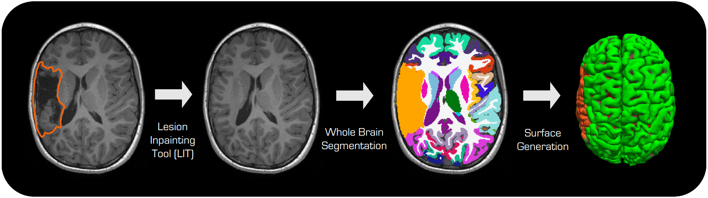

# Neuro Lesion Inpainting Tool (neuroLIT) 🔥



## Overview

This repository contains sourcecode and documentation related to our publication [**FastSurfer-LIT: Lesion Inpainting Tool for Whole Brain MRI Segmentation With Tumors, Cavities and Abnormalities**](https://doi.org/10.1162/imag_a_00446).
This tool can inpaint lesions independent of their shape or appearance for further downstream analysis. This allows subsequent analysis to run as if no lesion were present, enabling for example, FastSurfer's whole brain segmentation in cases with large brain tumors or surgical cavities. The extended documentation is located at [DeepMI.org/neurolit](https://Deep-MI.org/neurolit).

## Quickstart

### Docker / singularity

```bash
git clone https://github.com/Deep-MI/neurolit
cd neurolit
./neurolit/scripts/run_lit_containerized.sh --input_image T1w.nii.gz --lesion_mask lesion_mask.nii.gz --output_directory output_directory
# Add --singularity to use singularity instead of docker
```

### Pip

```bash
pip install neurolit
lit-inpainting --input_image T1w.nii.gz --lesion_mask lesion_mask.nii.gz --output_directory output_directory
```

The command uses the recommended fast preset by default: DDIM with 50 inference steps and RePaint
10/15. Add ``--slow`` to restore the original 1000-step DDPM inference behavior.

When preparing a FastSurfer subject directory directly, add `--fastsurfer_dir`. This writes the
LIT outputs directly into the FastSurfer subject structure, including `mri/inpainted.lit.nii.gz`,
the processed mask at `mri/mask.lit.nii.gz`, and the original input mask at
`mri/orig/mask.lit.nii.gz`.

## How to run neuroLIT

We recommend using containerization in combination with the [neurolit/scripts/run_lit_containerized.sh](neurolit/scripts/run_lit_containerized.sh) wrapper script.
This will automatically pull the Docker image from [Docker Hub](https://hub.docker.com/r/deepmi/lit) or create a Singularity image cache and run the neuroLIT inpainting. Additional `lit-inpainting` flags such as `--dilate 2` are forwarded through the wrapper to the container entrypoint.
If you do not pass `--tag`, the wrapper selects the newest numeric release tag available on Docker Hub (for example `0.7.0`), rather than Docker's floating `latest` tag.
We also have a pip release of neuroLIT.

### Running neuroLIT

The most straight forward way of doing the inpainting is just providing

1. The T1w image
2. The lesion mask
3. An output directory
4. (optional) The number times to dilate the lesion mask (default: 0)

```bash
./neurolit/scripts/run_lit_containerized.sh --input_image T1w.nii.gz --mask_image lesion_mask.nii.gz --output_directory output_directory --dilate 2
```

The default is to use Docker. Add the `--singularity` flag to use Singularity or Apptainer instead:

```bash
./neurolit/scripts/run_lit_containerized.sh --singularity --input_image T1w.nii.gz --mask_image lesion_mask.nii.gz --output_directory output_directory
```

On first use, the image is pulled from Docker Hub — **no root required**. The image is cached in `containerization/deepmi_lit_<version>.sif` and reused on subsequent runs.

If you already have a `.sif` file, pass it directly to skip the pull:

```bash
./neurolit/scripts/run_lit_containerized.sh --singularity_image /path/to/deepmi_lit.sif --input_image T1w.nii.gz --mask_image lesion_mask.nii.gz --output_directory output_directory
```

Both `singularity` and `apptainer` (the HPC-standard open-source fork) are supported automatically.

The outputs will be placed in the output directory in the folder inpainting_volumes and contain

- The inpainted T1w image (`inpainting_result.nii.gz`)
- The (dilated) mask used for inpainting in the same space as the input image (`inpainting_mask.nii.gz`)
- The conformed original image (`inpainting_original_image.nii.gz`)

With `--fastsurfer_dir`, these outputs are integrated into the FastSurfer subject directory instead:

- `mri/inpainted.lit.nii.gz`
- `mri/mask.lit.nii.gz`
- `mri/orig/mask.lit.nii.gz`
- `mri/orig/inpainting_original_image.lit.nii.gz`
- `mri/orig/inpainting_masked_image.lit.nii.gz`
- `scripts/inpainting_*.lit.png`

We recommend performing dilation, since undersegmentation can negatively impact the performance of the inpainting, while oversegmentation should not have significant impact.

The saved result preserves every voxel outside the effective lesion mask (including any requested
dilation) exactly relative to the conformed image. Conforming itself can change the grid and
robustly rescale intensities. With `--keepgeom`, the output uses the native input grid and copies
the original input intensities outside the mask exactly; generated intensities are converted
back to the native intensity scale. This does not guarantee identical downstream segmentations
or surfaces: a model can respond to changed tissue inside the lesion.

#### Installation from PyPI

The same interface as above can be accessed from pypi:

```bash
# Install the package
pip install neurolit

# Download model checkpoints (recommended - download once, ~700MB)
lit-download-models

# Run neuroLIT
lit-inpainting --input_image T1w.nii.gz --lesion_mask lesion_mask.nii.gz --output_directory output_directory --dilate 2
```

**Note:** If you skip the `lit-download-models` step, models will be automatically downloaded on first use.

## Expected Runtimes

Runtimes below are for a typical whole-brain T1w volume (1 mm isotropic), measured with neuroLIT v0.7.0:

| Hardware | Runtime |
|---|---|
| NVIDIA GeForce RTX 5070 Ti (16 GB) | ~17 minutes |
| Intel Xeon w5-2465X (CPU only) | ~5.5 hours |

GPU is strongly recommended for interactive use. CPU is feasible for batch/overnight processing.

## Integration with FreeSurfer/FastSurfer

neuroLIT is being integrated into [FastSurfer](https://github.com/deep-mi/FastSurfer) for whole brain segmentation and cortical surface reconstruction of images with lesions.

For FastSurfer 2.6.0, run neuroLIT in the FastSurfer Python environment (Python 3.12 or newer;
the distributed environment uses Python 3.14). Standalone neuroLIT still supports Python 3.10+.
If postprocessing runs in an older standalone environment, select FastSurfer's interpreter with
`--python-cmd /path/to/fastsurfer/python`; both the availability check and statistics use it.
The summary parser accepts current report rows and legacy comment-prefixed rows, and writes
`stats/lesion_impact_summary.json`. FastSurfer 2.6.0 already recognizes this filename as well as
older YAML summaries when preventing unsupported surface-only continuation after LIT.

For standalone usage with FreeSurfer/FastSurfer, neuroLIT provides post-processing scripts for integrating lesions into FastSurfer/FreeSurfer outputs. We recommend using the unified `lit-postprocessing` script which handles mapping the lesion mask to multiple segmentation files, running volume statistics (segstats), and performing surface masking.

### Postprocessing

This script modifies FastSurfer/FreeSurfer segmentations and surface annotation files, and the corresponading statistics (.stats) files.

```bash
# Setup paths
export FASTSURFER_HOME=/path/to/FastSurfer
export FREESURFER_HOME=/path/to/freesurfer
source $FREESURFER_HOME/SetUpFreeSurfer.sh

# Run unified postprocessing
lit-postprocessing \
    -sid SUBJECT_ID \
    -sd /path/to/subjects_dir
```

**Overview:**

- **Requirements**: Automatically checks for FastSurfer/FreeSurfer installations using `$FASTSURFER_HOME` and `$FREESURFER_HOME`. FreeSurfer is required for surface postprocessing.
- **Dynamic Configuration**: Uses `segstats_config.json` for volumetric stats and `surfstats_config.json` for surface stats. By default, all relevant FastSurfer annotation and segmentation files are modified.
- **Adjacent Label Reports**: Generates adjacency reports for lesion segmentations, allowing users to assess which regions are affected or replaced by the lesion.

The current postprocessing workflow updates the primary FastSurfer outputs in place, keeps the
pre-lesion versions as `.lit` backups or mapped backup files, and writes lesion-specific reports
such as `stats/aparc.DKTatlas+aseg.lesion_report.txt`, `stats/aseg.lesion_report.txt`, and
`stats/lesion_impact_summary.json`.

For corpus callosum outputs, postprocessing updates `stats/aseg.VINN.withCC.stats`,
matching current FastSurfer. The older names `stats/aseg.auto.stats` and
`stats/aseg.auto.mgz` remain compatible aliases (or copies when symlinks are unavailable).
When migrating an older subject, its first pre-lesion statistics backup is preserved.
The historical `.mgz` file in `stats/` is a text statistics table, not an MRI volume.

## Training

The training script can be found [here](neurolit/train_ddpm.py). The same docker image can be used for training, but you need to mount the training data directory using the `-v` flag. Note that training data are expected to be conformed (with the script [conform.py](neurolit/data/conform.py)).

## Documentation

Comprehensive documentation is available in the `doc/` directory and will be made public at [DeepMI.org/neurolit](https://Deep-MI.org/neurolit).

Documentation includes:

- Installation guides
- Usage tutorials
- API reference
- Contributing guidelines

## References

If you use neuroLIT for research publications, please cite:

_Pollak C, Kuegler D, Bauer T, Rueber T, Reuter M, FastSurfer-LIT: Lesion Inpainting Tool for Whole Brain MRI Segmentation with Tumors, Cavities and Abnormalities, Imaging Neuroscience 2025. <https://doi.org/10.1162/imag_a_00446>_
